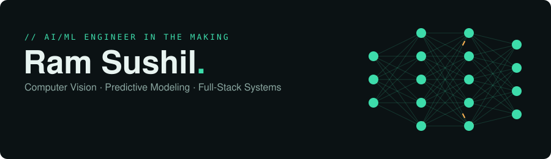

- 🎓 Final-year **B.Tech, AI & Data Science** student, Ajeenkya DY Patil University. CGPA 9.5/10 (Dean's List), graduating May 2027
- 🧠 Applied ML in **computer vision** (CNNs, transfer learning) and **predictive modeling** (regression, ensemble methods)
- ⚙️ Shipped a production system end-to-end as a Software Development Intern at **Bitwave Solutions**: OTP auth, payments, real-time dashboards, offline-first caching
- 🌱 Currently building with **LLM agents & RAG** (Hugging Face Agents course, AWS GenAI)
- 💬 Ask me about PyTorch, REST API design, ASP.NET / Spring Boot, or React

👇 Click a project to expand it

<b>🏥 Pathlab Patient Portal</b> · production system from my internship

 

- OTP login and appointment booking
- Razorpay payments
- Offline-first caching

`ASP.NET MVC` `WCF` `SQL Server` `Razorpay`

[View repository →](https://github.com/ramsharmas/Pathlab_portal)

<b>🧠 Brain Tumor MRI Classifier</b> · 4-class MRI classification

 

- ResNet18 transfer learning
- Grad-CAM interpretability
- Gradio dashboard

`PyTorch` `Computer Vision` `Gradio`

[View repository →](https://github.com/ramsharmas/brain-tumor-mri-classification-resnet18-main)

<b>🏠 Housing Price Prediction</b> · regression models served as an API

 

- Linear Regression vs. Random Forest (87% accuracy)
- Preprocessing, feature engineering and exploratory analysis
- Flask REST API

`scikit-learn` `Pandas` `Flask`

[View repository →](https://github.com/ramsharmas/Machine-Learning-Based-Housing-Price-Prediction-System)

<b>🎯 JobFit AI</b> · resume-to-job matcher and interview prep

 

- Scores a resume against a job description
- Skill-gap analysis
- Targeted interview questions

`Python` `RAG` `Agents` `Streamlit`

[View repository →](https://github.com/ramsharmas/jobfit-ai)

**AI / ML** 

**Languages** 

**Backend** 

**Frontend** 

**Databases & tools** 

<picture>
<source media="(prefers-color-scheme: dark)" srcset="https://raw.githubusercontent.com/ramsharmas/ramsharmas/output/snake-dark.svg"/>

</picture>

<b>📜 Show my 5 certifications</b>

- Data Structures & Algorithms (Java), Infosys Springboard
- SQL Server: Novice to Ninja, Infosys Springboard
- Machine Learning for Healthcare, MIT (Cursa)
- Fundamentals of Agents, Hugging Face
- Gen AI Revolution, AWS × AspireForHer

